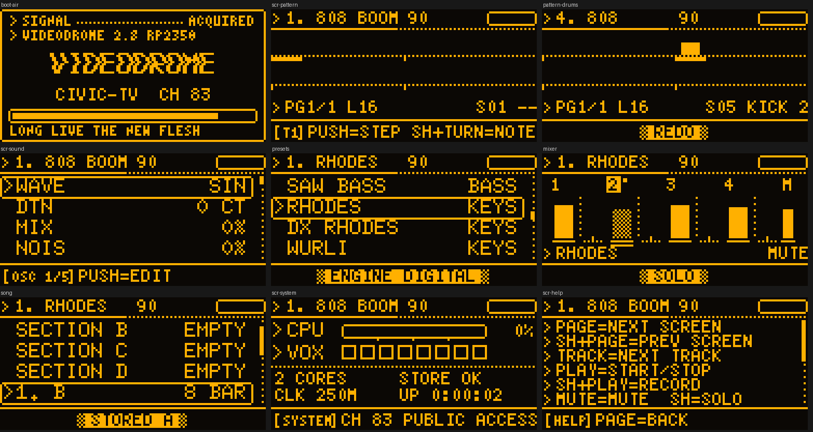

# VIDEODROME on the RP2350 (the xtro board)

The Videodrome synth from the FM-1 / SMK-37 firmware, on [xtro](https://github.com/leeman1982/xtro)'s hardware: a
Raspberry Pi Pico 2 (RP2350, 16 MB flash), a PCM5102A DAC, a 128×64 SSD1309 OLED, one encoder and five buttons, two
octave switches, two pots, and DIN MIDI in and out. Same pinout as xtro, pin for pin. Its OLED UI is in xtro's "84"
terminal style.

> **Status: untested on hardware.**
>
> - It builds for the RP2350 with arduino-pico 6.3.0: 566 KB of flash, 353 KB of static RAM, 158 KB of heap free.
> - The same code runs on the host against U8g2's real C core and passes its tests. They cover the boot log, sound
>   from MIDI IN, every screen and its controls, MIDI clock out, the click out, storage across a restart, and a
>   20,000-frame fuzz.
> - Nothing has run on a real board yet.

## What is the FM-1's, and what is new

**The synth is the FM-1's own code, unchanged.** `tools/rp2350_sync.py` copies `firmware/src` into the sketch
(`Videodrome/fw/`, checked by `rp2350/test/run.sh`), and the sketch builds it as one C file, as `felucca.c` does on the
FM-1. That covers:

- the six component-level models (Model D, P-5, JP-8, OB-X, MS-20, CS-80) and SLOOP's twelve engines;
- the 37 drum kits;
- the sequencer: four tracks, locks, ratchets, fills;
- the arpeggiator and chords;
- the effects;
- the sections A–D and the song chain;
- user presets;
- the projects. They are saved in the FM-1's own format: same objects, same CRCs.

Only one FM-1 source changed, `gfx.c`: its canvas size can be overridden (the OLED needs none; the FM-1's build is
unchanged).

**The UI is new, but its actions are the FM-1's.** Each control calls the function the FM-1's UI calls for the same
action (`edit_param`, `preset_go`, `select_engine`, `section_store`, `undo_swap`, …). Every parameter page is a page of
the FM-1's own table, with its own value formatting.

**What did not come across**, because this panel can't do it, or not yet:

| FM-1 feature | Here |
|---|---|
| The 37 keys and the layers on them (punch-in FX, roll, erase, the SEQ and MIX layers) | No keys: notes come from MIDI IN. Mute, solo, undo and steps are on the panel. |
| USB MIDI, the web editor, the uploader, USB audio | **Not yet.** MIDI is the DIN pair. Updates go as a `.uf2` (BOOTSEL), not through the uploader. |
| Loading your own samples | The slots exist, but there is no way to load them without the editor. |
| The visualiser, colour themes, the 240×240 screens | The OLED has its own screens. |
| MASTER knob | No pot for it: MIXER → **M** (starts at −3 dB). |

## Hardware

Identical to xtro: see [xtro's README, "Wiring"](https://github.com/leeman1982/xtro#wiring).

| Function | Pin | | Function | Pin |
|---|---|---|---|---|
| MIDI IN (PIO UART) | GP0 | | BTN PLAY | GP9 |
| MIDI OUT (PIO UART) | GP1 | | BTN SHIFT | GP10 |
| OCT DOWN | GP2 | | BTN PAGE | GP11 |
| OCT UP | GP3 | | BTN TRACK | GP12 |
| OLED SDA (0x3C) | GP4 | | BTN MUTE | GP13 |
| OLED SCL | GP5 | | CLICK / GATE OUT | GP14 (5 ms high a beat while playing) |
| ENC A / B / SW | GP6 / GP7 / GP8 | | I2S BCK / LRCK / DIN | GP15 / GP16 / GP17 |
| POT CUTOFF | GP26 | | POT RESONANCE | GP27 |

## Build and flash

1. Install the Arduino IDE.
2. Add the **arduino-pico** core: Boards Manager URL
   `https://github.com/earlephilhower/arduino-pico/releases/download/global/package_rp2040_index.json`.
3. Install the **U8g2** library from the Library Manager.
4. Open `rp2350/Videodrome/Videodrome.ino` and set the Tools menu:

| Tools | Setting |
|---|---|
| Board | **Generic RP2350** (or Raspberry Pi Pico 2) |
| Flash Size | **16MB (Sketch: 14MB, FS: 2MB)**: any FS of 1 MB or more. Projects, sections and presets live there. |
| CPU Speed | **250 MHz**: see *Performance*. 150 MHz plays, with fewer voices under load. |
| Optimize | **Optimize More (-O2)** |
| USB Stack | Pico SDK |

5. Hold BOOTSEL while plugging in, then Upload. Or use Sketch → Export Compiled Binary and copy the `.uf2` onto the
   RPI-RP2 drive.

From the command line: `arduino-cli compile --fqbn rp2040:rp2040:generic_rp2350:flash=16777216_2097152,freq=250,opt=Optimize2 rp2350/Videodrome`.

## Controls

| Control | Does |
|---|---|
| **PAGE** / SHIFT+PAGE | Next / previous screen: PATTERN, SOUND, PRESETS, MIXER, SONG, SYSTEM, HELP |
| **TRACK** / SHIFT+TRACK | Next / previous track (1–3 synths, 4 drums) |
| **PLAY** | Start / stop. **SHIFT+PLAY**: record (arm; MIDI IN notes are recorded) |
| **MUTE** / SHIFT+MUTE | Mute / solo the track (on MIXER: the cursor's track) |
| **OCT− / OCT+** | Octave of a MIDI keyboard (both: 0). **SHIFT+OCT− / +**: undo / redo |
| **Encoder** | Turn: cursor (a value while editing). Push: the screen's action. Long push: back to PATTERN |
| **CUTOFF / RESONANCE pots** | The selected track's own cutoff and resonance; the drums: the track filter |

Per screen:

- **PATTERN** shows 16 steps as xtro's step cells: the play head is the lid, the cursor the underbar.
  - Push sets or clears a step. A synth step gets the last note played on MIDI IN. A drum step gets the sound picked
    with SHIFT+turn.
  - SHIFT+turn on a synth step moves its note.
- **SOUND** is every page of the track's sound as one list: engine, envelope, LFO, effects, arpeggiator, key and
  chords, pattern, globals, tools.
  - The footer chip names the page, e.g. `[OSC 1/5]`. Push edits the row; SHIFT+turn jumps a page.
  - LOAD, SAVE and CLEAR ask twice, as on the FM-1.
- **PRESETS**: turn loads, SHIFT+turn changes the engine, push sets a favourite. On the drums: their kits.
- **MIXER** shows the four tracks as bars (muted ones hatched, soloed ones with a pip) and the master.
  - Push, then turn: the level. SHIFT+turn: the pan.
- **SONG** lists the sections A–D, then the chain.
  - On a section: push loads it, SHIFT+push stores the loop into it.
  - On a chain step: push edits it (turn picks its section, SHIFT+turn its bars).
  - Then LENGTH, MODE (loop / song) and SAVE SONG.
- **SYSTEM** shows the CPU, the voices sounding out of 8, the cores, the storage, the clock and the uptime.

Messages ("SAVED", "AGAIN: LOAD", …) appear as xtro's hatched banner in the footer.

**MIDI:**

- MIDI IN plays the selected track. Each track's channel, the drums' channel and the clock source are set under SOUND →
  GLOBAL → MIDI, as on the FM-1.
- Program change picks from the PRESETS list.
- MIDI OUT carries the sequencer's notes and, with CLOCK OUT set, the clock.

## Performance (estimated: measured without a board)

**Method:** the FM-1's render (`mix_block`) was compiled for the Cortex-M33 with the arduino-pico toolchain (GCC
-O2) and run in an instruction-level emulator (unicorn): 8 voices held, the drums playing, the effects on.

Instructions per 32-sample block:

| Engine | Instructions |
|---|---|
| Idle (drums + effects only) | ~22,000 |
| ANALOG | ~54,000 |
| CS-80 | ~74,000 |
| JP-8 (the heaviest model) | ~97,000 |
| PHYS | ~103,000 (3 voices) |
| Model D, MS-20 | mono instruments, ~33,000 |

**The flash cache:** the same run, replayed through a model of the RP2350's 16 KB, 2-way XIP cache, gives 600–900
misses a block. The render touches only 4–6 KB of flash lines, so the misses are conflicts, not capacity.

**Estimated load:** at an assumed 1.2 cycles per instruction and 30 cycles per miss, the worst case (JP-8, 8 voices,
drums, effects) is about **80% of core 0 at 250 MHz**.

- Core 1 takes the third track and the drums each block, as on the FM-1.
- At 150 MHz the worst case does not fit, and the FM-1's guard sheds voices (two late half-buffers in a row).
- The cycles-per-instruction and miss costs are guesses. On a board, SYSTEM shows the real figure.

**Stack:** the deepest render path measured 1.4 KB (PHYS). Core 0 has 8 KB, because core 1 is moved onto its own 8 KB
stack from the heap.

## How it runs

| Where | What |
|---|---|
| Core 0, I2S DMA interrupt | Renders each free buffer, 256 frames at 44.1 kHz in 32-sample blocks: the FM-1's audio interrupt (`vd_audio_fill`) |
| Core 0, 1 kHz timer | The millisecond clock; MIDI in (the FM-1's UART parser); MIDI out (the SMK-37's TRS-out code, one whole message or none); the click out (`vd_tick`) |
| Core 0, `loop()` | Panel, OLED (only the changed rows, two per pass), and the FM-1's per-frame work: program change, MIDI learn, autosave, section writes when quiet (`vd_frame`) |
| Core 1, `loop1()` | Its share of each render block, through the FM-1's second-core API (`vd_cpu1.h`, with the FM-1's self-test at boot) |

**Interrupt priorities:** the render's DMA interrupt is the lowest priority. The PIO UART's receive interrupt, the
1 kHz tick, the encoder and USB all nest into it, as the FM-1's input tick outranks its audio interrupt. The PIO receive
FIFO holds 4 bytes, about 1.3 ms of MIDI; a render takes up to ~5 ms.

**Flash writes:** they erase and program the FS partition with core 1 parked and interrupts off. The audio drops out for
the duration, as on the FM-1, which only writes when stopped and quiet. `tools/rp2350_check_elf.py` checks that the
FM-1's own RAM sections start zeroed.

## Files

| Path | What |
|---|---|
| `Videodrome/Videodrome.ino` | The board: I2S, OLED, controls, MIDI, flash, the two cores |
| `Videodrome/config.h` | xtro's pinout, the FM-1's audio constants |
| `Videodrome/controls.*` | xtro's encoder, buttons and pots (plus a press edge for PLAY) |
| `Videodrome/vd_core.c` | The synth as one translation unit: the FM-1's sources in `felucca.c`'s order |
| `Videodrome/vd_port.h`, `vd_glue.h`, `vd_flash.h`, `vd_cpu1.h` | What the FM-1's sources expect of their hardware, made of the RP2350's |
| `Videodrome/vd_ui.h`, `vd_gfx.h`, `vd_wordmark.h` | The OLED UI, xtro's drawing vocabulary in C, the boot wordmark |
| `Videodrome/vd_rp.h`, `vd_api.h` | The runtime and the calls between the sketch and the synth |
| `Videodrome/fw/` | The FM-1's sources, copied (`tools/rp2350_sync.py`; don't edit there) |
| `port/hal/` | The three FM-1 hardware headers replaced for this board (flash window, no UART1, no USB0) |
| `test/` | The host test (`rp2350_test.c`) and `run.sh` (sync check, host test, the RP2350 builds, the ELF check) |

After changing `firmware/src`, run `python3 tools/rp2350_sync.py`, then `rp2350/test/run.sh`.
